<div align="center">

# 🚀 EduTurmas

**Aplicativo mobile para gestão escolar de turmas, avaliações e correção inteligente de provas por meio de leitura de cartões de resposta (OMR).**


</div>

## 👥 Equipe

| Nome completo          |
| ---------------------- |
| Adrian Riegel          |
| Emiliano Adamski Stack |
| Kaue Keiser Lindner    |
| Matheus Machado        |
| Heitor Fugel           |

## 📑 Sumário

- [1. Visão Geral](#1-visão-geral)
- [2. Requisitos](#2-requisitos)
  - [2.1 Funcionais (RF)](#21-funcionais-rf)
  - [2.2 Não Funcionais (RNF)](#22-não-funcionais-rnf)
- [3. Telas do Sistema](#3-telas-do-sistema)
- [4. Modelo de Dados](#4-modelo-de-dados)
- [5. Stack Tecnológica](#5-stack-tecnológica)
- [6. Estrutura de Pastas](#6-estrutura-de-pastas)
- [7. Como Executar o Projeto](#7-como-executar-o-projeto)
- [8. Backlog de Atividades da N2](#8-backlog-de-atividades-da-n2)

---

## 1. Visão Geral

📌 **N1**

O EduTurmas é uma solução mobile desenvolvida para professores e instituições que precisam organizar turmas, criar avaliações e corrigir provas de forma mais rápida e segura. O problema principal é o esforço manual envolvido em manter o controle de alunos, gabaritos e notas, além da necessidade de reduzir erros na correção de provas com cartão de resposta.

A aplicação centraliza o cadastro de turmas, alunos e avaliações, além de automatizar a leitura e o cálculo de notas por meio de processamento OMR. Com isso, o professor consegue acompanhar desempenho por turma, revisar casos ambíguos e gerar relatórios sem depender de processos fragmentados ou manuais.

## 2. Requisitos

📌 **N1**

### 2.1 Funcionais (RF)

| Código | Requisito                                                                                                    |
| ------ | ------------------------------------------------------------------------------------------------------------ |
| RF01   | O sistema deve permitir que o professor realize cadastro, login e recuperação de senha.                      |
| RF02   | O sistema deve permitir a criação, edição e listagem de turmas.                                              |
| RF03   | O sistema deve permitir o cadastro individual e a importação em massa de alunos.                             |
| RF04   | O sistema deve permitir a criação de avaliações com título, disciplina, data e questões.                     |
| RF05   | O sistema deve permitir a definição e edição do gabarito oficial da avaliação.                               |
| RF06   | O sistema deve permitir a captura de imagens de provas e a correção automatizada por leitura OMR.            |
| RF07   | O sistema deve identificar respostas ambíguas ou em branco e abrir revisão manual antes de finalizar a nota. |
| RF08   | O sistema deve calcular notas, estatísticas e gerar relatórios de desempenho.                                |
| RF09   | O sistema deve permitir a visualização e atualização do perfil do professor.                                 |
| RF10   | O sistema deve atribuir nota zero para alunos ausentes ao encerrar a correção.                               |

### 2.2 Não Funcionais (RNF)

| Código | Requisito                                                                                                                 |
| ------ | ------------------------------------------------------------------------------------------------------------------------- |
| RNF01  | O sistema deve responder de forma ágil em uma rede padrão, com carregamento de telas e consultas em tempo aceitável.      |
| RNF02  | Os dados do professor devem permanecer isolados por conta e por turma, respeitando o controle de acesso do Firebase.      |
| RNF03  | A autenticação deve ser protegida e manter sessão ativa no dispositivo para facilitar o uso diário.                       |
| RNF04  | O app deve ser compatível com ambientes mobile Flutter e oferecer boa experiência em Android.                             |
| RNF05  | A aplicação deve suportar importação de arquivos e dados em formatos comuns, como CSV, sem quebrar a rotina do professor. |

## 3. Telas do Sistema

📌 **N1**

A sequência de telas abaixo representa o fluxo principal do uso do app: login, gestão de turmas, criação de avaliações e correção dos resultados.

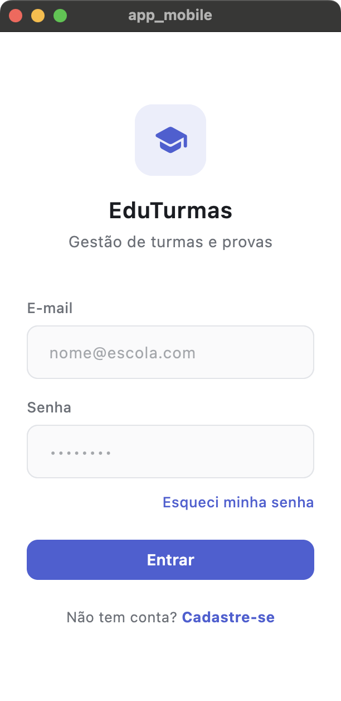
_Tela de login: autenticação do professor com e-mail e senha._

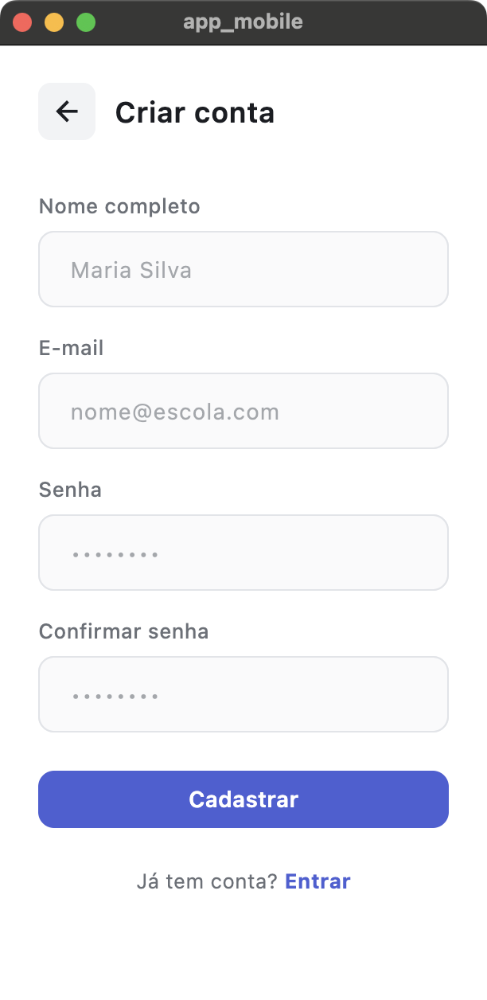
_Tela de cadastro: criação da conta do professor e definição de dados básicos._

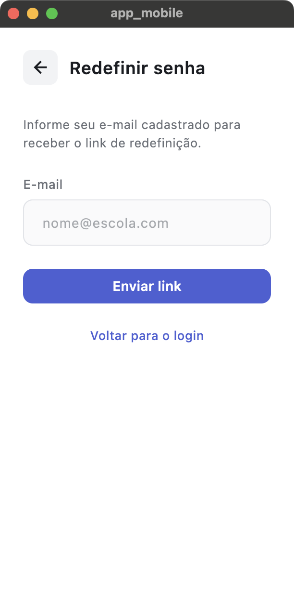
_Tela de redefinição de senha: recuperação do acesso ao sistema._

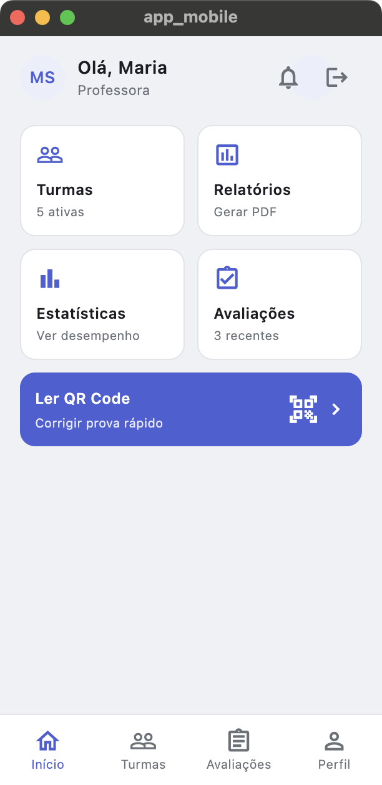
_Dashboard: visão geral das turmas e atividades do professor._

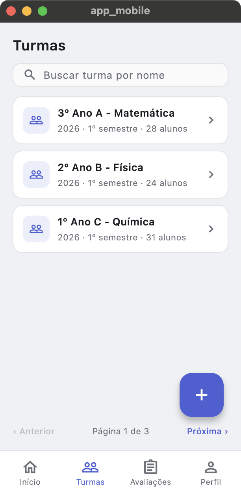
_Lista de turmas: cadastro e consulta das classes ativas._

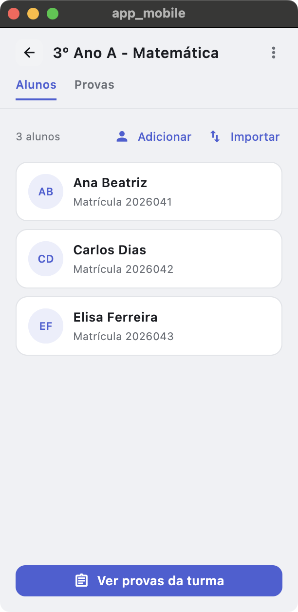
_Detalhe da turma: gestão de alunos e acompanhamento da turma._

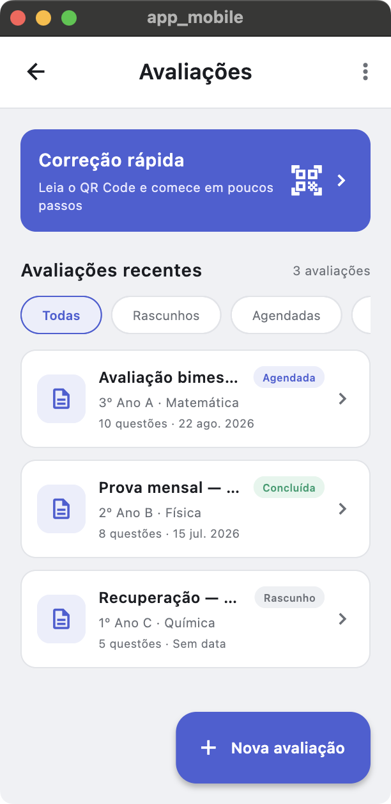
_Painel de avaliações: listagem das provas vinculadas a cada turma._

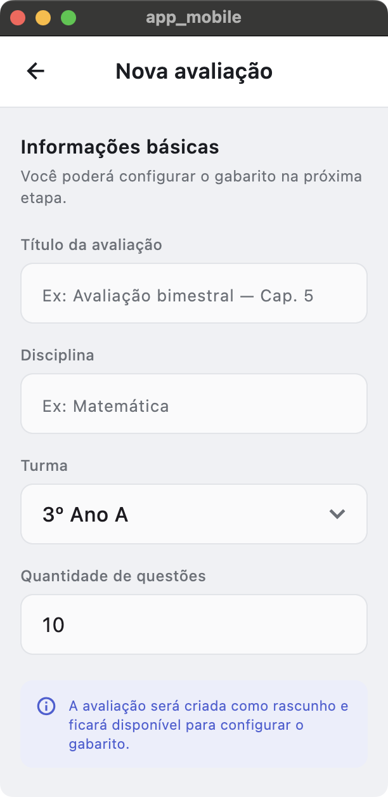
_Criação da avaliação: definição de título, disciplina e questões._

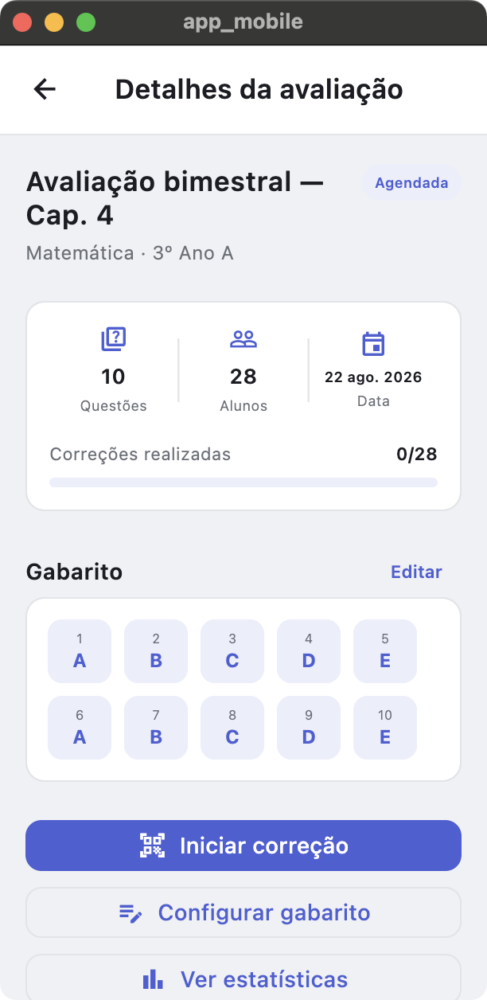
_Detalhe da avaliação: visualização da prova e do status da correção._

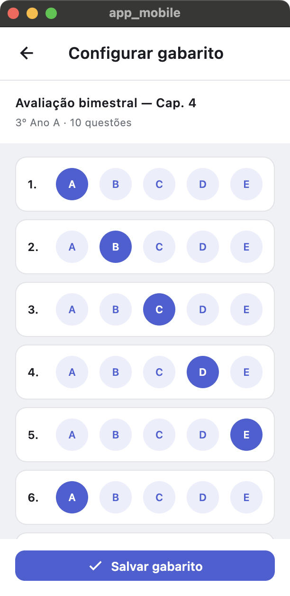
_Configuração do gabarito: definição das respostas oficiais da prova._

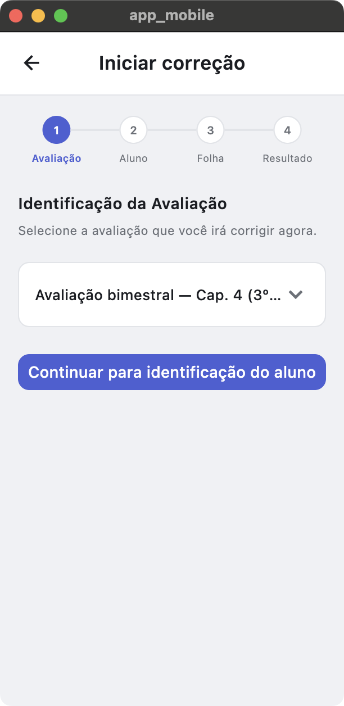
_Correção OMR: processamento da imagem e revisão da avaliação._

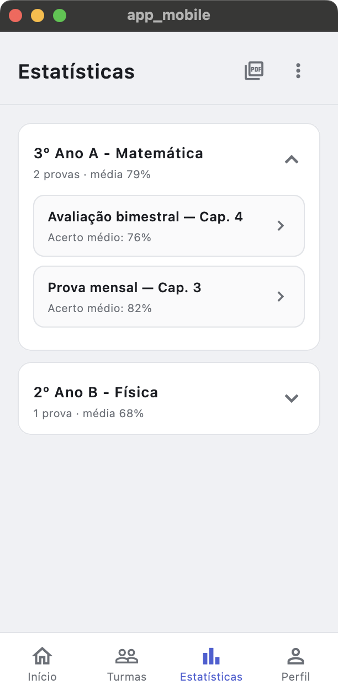
_Estatísticas gerais: visão consolidada do desempenho por turma._

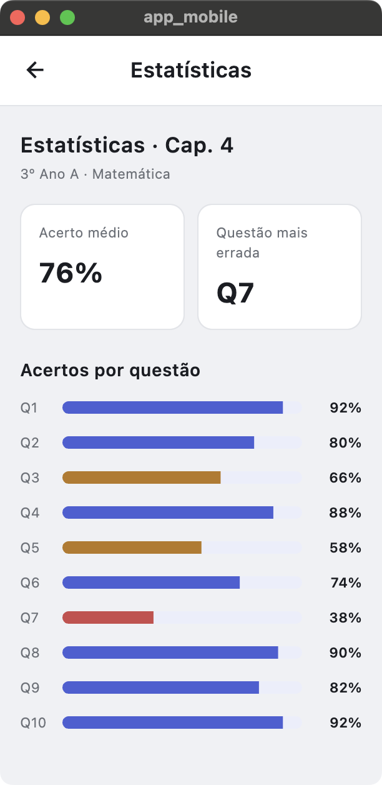
_Estatísticas da prova: análise por questão e taxa de acerto._

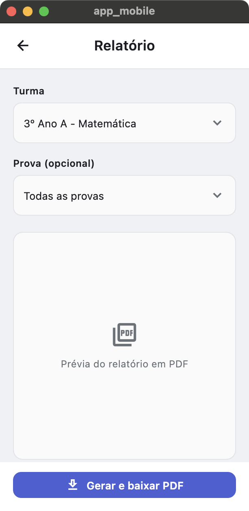
_Relatório: geração de dados de desempenho em formato visual._

## 4. Modelo de Dados

📌 **N3**

O banco de dados da aplicação é o Firestore, que armazena documentos em coleções no formato JSON. A estrutura abaixo representa a organização dos dados principais do sistema.

### Coleção: usuarios

```json
{
  "id": "uid_do_professor",
  "nome": "Maria Silva",
  "email": "maria@escola.com",
  "escola": "Escola Estadual Exemplo",
  "disciplinaPrincipal": "Matemática",
  "notificacoesEmail": true,
  "ativo": true,
  "criadoEm": "2026-10-29T12:00:00Z"
}
```

| Campo               | Tipo      | Descrição                                         |
| ------------------- | --------- | ------------------------------------------------- |
| id                  | String    | Identificador único do professor no Firebase Auth |
| nome                | String    | Nome completo do professor                        |
| email               | String    | E-mail utilizado para autenticação                |
| escola              | String    | Instituição de ensino do professor                |
| disciplinaPrincipal | String    | Disciplina principal de atuação                   |
| notificacoesEmail   | Boolean   | Preferência para envio de notificações            |
| ativo               | Boolean   | Status da conta do professor                      |
| criadoEm            | Timestamp | Data de criação do perfil                         |

### Coleção: turmas

```json
{
  "id": "tur_001",
  "professorId": "uid_do_professor",
  "descricao": "3º Ano A - Matemática",
  "semestre": 1,
  "ano": 2026,
  "totalAlunos": 28,
  "criadoEm": "2026-10-29T12:00:00Z"
}
```

| Campo       | Tipo      | Descrição                    |
| ----------- | --------- | ---------------------------- |
| id          | String    | Identificador único da turma |
| professorId | String    | UID do professor responsável |
| descricao   | String    | Nome ou descrição da turma   |
| semestre    | Number    | Semestre letivo              |
| ano         | Number    | Ano letivo                   |
| totalAlunos | Number    | Quantidade total de alunos   |
| criadoEm    | Timestamp | Data de criação da turma     |

### Coleção: alunos

```json
{
  "id": "alu_001",
  "professorId": "uid_do_professor",
  "turmaId": "tur_001",
  "nome": "João Pereira",
  "matricula": "2026041",
  "criadoEm": "2026-10-29T12:00:00Z"
}
```

| Campo       | Tipo      | Descrição                            |
| ----------- | --------- | ------------------------------------ |
| id          | String    | Identificador único do aluno         |
| professorId | String    | UID do professor dono da turma       |
| turmaId     | String    | Referência para a turma do aluno     |
| nome        | String    | Nome do aluno                        |
| matricula   | String    | Matrícula ou código de identificação |
| criadoEm    | Timestamp | Data de cadastro do aluno            |

### Coleção: avaliacoes

```json
{
  "id": "ava_001",
  "professorId": "uid_do_professor",
  "turmaId": "tur_001",
  "titulo": "Avaliação Bimestral - Capítulo 4",
  "disciplina": "Matemática",
  "status": "concluida",
  "dataAplicacao": "2026-10-29T13:00:00Z",
  "totalQuestoes": 10,
  "gabarito": [
    { "questao": 1, "alternativaCorreta": "B", "peso": 1.0 },
    { "questao": 2, "alternativaCorreta": "A", "peso": 1.0 }
  ],
  "criadoEm": "2026-10-29T12:00:00Z"
}
```

| Campo         | Tipo      | Descrição                                                 |
| ------------- | --------- | --------------------------------------------------------- |
| id            | String    | Identificador único da avaliação                          |
| professorId   | String    | UID do professor responsável                              |
| turmaId       | String    | Turma à qual a avaliação pertence                         |
| titulo        | String    | Título da avaliação                                       |
| disciplina    | String    | Disciplina da prova                                       |
| status        | String    | Estado da avaliação (`rascunho`, `agendada`, `concluida`) |
| dataAplicacao | Timestamp | Data prevista ou realizada                                |
| totalQuestoes | Number    | Quantidade total de questões                              |
| gabarito      | Array     | Lista com as respostas corretas e pesos                   |
| criadoEm      | Timestamp | Data de criação                                           |

### Coleção: resultados

```json
{
  "id": "ava_001_alu_001",
  "professorId": "uid_do_professor",
  "avaliacaoId": "ava_001",
  "turmaId": "tur_001",
  "alunoId": "alu_001",
  "respostasAluno": [
    { "questao": 1, "alternativaMarcada": "B", "correta": true },
    { "questao": 2, "alternativaMarcada": "C", "correta": false }
  ],
  "totalAcertos": 1,
  "notaCalculada": 5.0,
  "ausente": false,
  "corrigidoEm": "2026-10-29T14:30:00Z"
}
```

| Campo          | Tipo      | Descrição                                         |
| -------------- | --------- | ------------------------------------------------- |
| id             | String    | Chave composta da correção: `avaliacaoId_alunoId` |
| professorId    | String    | UID do professor responsável                      |
| avaliacaoId    | String    | Identificador da prova corrigida                  |
| turmaId        | String    | Turma da avaliação                                |
| alunoId        | String    | Identificador do aluno avaliado                   |
| respostasAluno | Array     | Respostas marcadas pelo aluno e status de acerto  |
| totalAcertos   | Number    | Quantidade de acertos do aluno                    |
| notaCalculada  | Number    | Nota final com base no peso das questões          |
| ausente        | Boolean   | Indicador de ausência na prova                    |
| corrigidoEm    | Timestamp | Data da correção                                  |

## 5. Stack Tecnológica

📌 **N1**


- **Flutter**: framework principal para a construção da interface e da navegação do aplicativo.
- **Dart**: linguagem de programação utilizada para implementar a lógica do app e a integração com serviços externos.
- **Firebase Authentication**: autenticação do professor com e-mail e senha, com controle de sessão no app.
- **Firebase Firestore**: banco de dados NoSQL para armazenamento de usuários, turmas, alunos, provas e resultados.
- **file_picker**: importação de arquivos, como CSV para cadastro em massa de alunos.
- **pdf e printing**: geração e renderização de relatórios e boletins em PDF.
- **shared_preferences**: persistência local de configurações e estado de sessão.
- **flutter_dotenv**: carregamento de variáveis de ambiente e configuração do projeto.

## 6. Estrutura de Pastas

📌 **N1**

```text
lib/
  components/          # componentes reutilizáveis da interface
  models/              # modelos e entidades do domínio do sistema
  Screens/             # telas do aplicativo
  services/            # regras de negócio e integração com Firebase
  theme/               # temas visuais e estilos do app
  firebase_options.dart # configuração do Firebase para plataformas
  main.dart            # ponto de entrada da aplicação

docs/
  screenshots/         # capturas das telas do sistema
  database_schema.md   # documentação do esquema do Firestore
  pesquisa_cartao_respostas.md # estudo técnico sobre leitura OMR

android/               # projeto Android
ios/                   # projeto iOS
windows/               # projeto Windows
linux/                 # projeto Linux
macos/                 # projeto macOS
web/                   # projeto web
firestore.rules        # regras de segurança do Firestore
firestore.indexes.json # índices de consulta do Firestore
pubspec.yaml           # dependências e configuração do Flutter
analysis_options.yaml  # regras do linter
```

## 7. Como Executar o Projeto

📌 **N1**

1. Clone o repositório:

   ```bash
   git clone https://github.com/AdrianRiegel/app_mobile.git
   cd app_mobile
   ```

2. Instale as dependências do Flutter:

   ```bash
   flutter pub get
   ```

3. Configure o Firebase no projeto:
   - Verifique se o arquivo `firebase_options.dart` já existe.
   - Caso não exista, gere a configuração com o FlutterFire:

   ```bash
   flutterfire configure --project=<id-do-projeto> --platforms=android,ios,web
   ```

   - Confirme que os arquivos de configuração do Firebase estejam na estrutura correta do app.

4. Execute a aplicação:

   ```bash
   flutter run
   ```

5. Se houver necessidade de rodar em emulador ou dispositivo físico, certifique-se de que o ambiente de desenvolvimento esteja configurado corretamente e que o projeto tenha sido sincronizado com a conta Firebase do professor.

## 8. Backlog de Atividades da N2

📌 **N2**

### Adrian Riegel

| Tarefa                                                              | Prazo | Status    |
| ------------------------------------------------------------------- | ----- | --------- |
| Definição da estrutura do banco e das collections do Firestore      | 15/09 | Concluído |
| Integração com o Firebase e configuração inicial do backend         | 18/09 | Concluído |
| Desenvolvimento da funcionalidade de cadastro, login e autenticação | 22/09 | Concluído |
| Implementação da página de perfil e configurações do professor      | 25/09 | Concluído |
| Desenvolvimento da leitura do cartão de resposta e pesquisa de OMR  | 08/10 | Concluído |
| Implementação da correção automática da prova e atribuição de nota  | 10/10 | Concluído |
| Finalização da correção para alunos ausentes e ajustes de fluxo     | 12/10 | Concluído |
| Reforço da navegação e refinamento das telas de avaliação           | 15/10 | Concluído |

### Emiliano Adamski Stack

| Tarefa                                                             | Prazo | Status    |
| ------------------------------------------------------------------ | ----- | --------- |
| Ajustes de build e configuração do projeto                         | 20/09 | Concluído |
| Implementação do tema global do aplicativo                         | 27/09 | Concluído |
| Componentização e refatoração das telas e módulos reutilizáveis    | 30/09 | Concluído |
| Implementação do componente de importação CSV e integração inicial | 02/10 | Concluído |
| Integração de comunicação com o banco e ajustes de arquitetura     | 05/10 | Concluído |
| Suporte na documentação e atualização do README                    | 10/10 | Concluído |

### Kaue Keiser Lindner

| Tarefa                                                            | Prazo | Status    |
| ----------------------------------------------------------------- | ----- | --------- |
| Componentização do projeto e organização de widgets reutilizáveis | 25/09 | Concluído |
| Desenvolvimento do componente de envio de e-mail                  | 30/09 | Concluído |
| Auxílio na arquitetura de módulos e refatorações do projeto       | 05/10 | Concluído |
| Participação em ajustes de integração e estrutura do banco        | 08/10 | Concluído |

### Matheus Machado

| Tarefa                                                          | Prazo | Status    |
| --------------------------------------------------------------- | ----- | --------- |
| Conclusão dos fluxos de turmas, autenticação e QR code da prova | 15/10 | Concluído |
| Desenvolvimento do fluxo visual de avaliações e provas          | 20/09 | Concluído |
| Ajustes de navegação e integração dos dados entre telas         | 04/10 | Concluído |

### Heitor Fugel

| Tarefa                                                     | Prazo | Status    |
| ---------------------------------------------------------- | ----- | --------- |
| Geração dos relatórios em PDF e estatísticas finais        | 15/09 | Concluído |
| Implementação do botão de voltar nas telas de estatísticas | 20/09 | Concluído |
| Testes de borda da correção e atribuição de notas          | 25/09 | Concluído |
| Ajustes de usabilidade em relatórios e correções           | 30/09 | Concluído |

---
